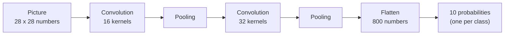
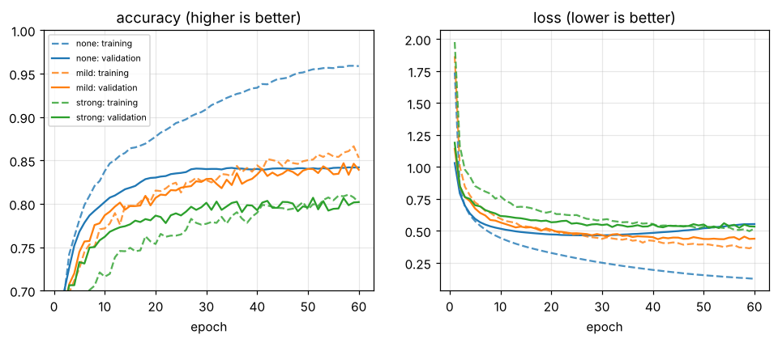
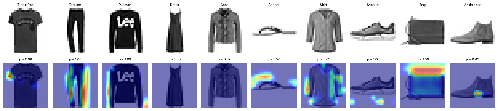

# FashionNet: learn convolutional neural networks step by step

> **After this tutorial you will be able to** explain how a computer "sees" a picture, build a small convolutional
> neural network (CNN) for clothes images, make it more robust with augmentation, judge it honestly, and
> look inside it with Grad-CAM.

[](https://colab.research.google.com/github/maryammahmoudi1993/FashionNet/blob/main/notebooks/01_images_as_numbers_and_first_cnn.ipynb)

> **Status:** all three notebooks are ready.

## Who this is for

- **For:** learners who know basic Python and NumPy and have never trained a neural network on images.
- **Not needed:** a GPU, a maths degree, or your own data. Everything runs on a laptop CPU.
- **Time:** about 25 minutes for notebook 01 (about one minute of training) about 30 minutes for notebook 02 (about six minutes of training) and about 30 minutes for notebook 03 (about one minute of training).

## What you will learn

- A picture is a grid of numbers, and why that matters. (notebook 01)
- What a convolution and a pooling layer do, shown with hand-made kernels. (01)
- How to train a first CNN and why it beats a network that ignores pixel neighbours. (01)
- Why we keep separate training, validation and test sets. (01)
- How to spot a network that memorises, and how to test data augmentation honestly with several seeds. (02)
- How to read a confusion matrix to see which classes get mixed up. (02)
- How to compute a Grad-CAM heat map from scratch, read it, and test it with an occlusion experiment instead of trusting it blindly. (03)

## The pipeline in one picture



<p align="center">
  <br>
  <em>A convolution slides a small kernel over the picture. The vertical-edge kernel lights up the sides of the dress,
  the horizontal-edge kernel lights up shoulders and hem.</em>
</p>

## How to run

**In the browser (no installation):** click the Colab badge above. Colab already has TensorFlow;
the first cell downloads this repository for you.

**On your computer** (Python 3.13 was tested; any recent Python 3 that TensorFlow supports should work):

```bash
git clone https://github.com/maryammahmoudi1993/FashionNet.git
cd FashionNet
python -m venv .venv
source .venv/bin/activate
pip install -r requirements.txt
python -m ipykernel install --user --name python3
jupyter lab notebooks/
```

If `jupyter` is not found, run `pip install jupyterlab` first (it is not needed to run the tests).

Check that everything works (runs the smoke tests and every notebook, about nine minutes):

```bash
python -m pytest -q
```

The data (Fashion-MNIST, a few megabytes) is downloaded automatically on the first run; see [`data/README.md`](data/README.md).

## Contents

| # | Notebook | You will learn | Status |
|---|---|---|---|
| 01 | [Images are numbers: your first CNN](notebooks/01_images_as_numbers_and_first_cnn.ipynb) | pixels, convolution, pooling, a first CNN, honest evaluation | ready |
| 02 | [Make it robust: augmentation, learning curves, confusion matrix](notebooks/02_augmentation_curves_confusion.ipynb) | memorising versus learning, augmentation tested with 3 seeds, reading a confusion matrix | ready |
| 03 | [Looking inside: Grad-CAM](notebooks/03_grad_cam_looking_inside.ipynb) | Grad-CAM step by step, heat maps for correct and wrong predictions, an occlusion test of the heat map and its limits | ready |

Other folders: [`src/`](src) shared code, [`tests/`](tests) smoke test and a test that runs every notebook,
[`legacy/`](legacy) the original 2023 files (untouched), [`assets/`](assets) figures and [credits](assets/CREDITS.md).

## Results so far

### Notebook 01: first CNN

All numbers below come from running notebook 01 (fixed seed 42, CPU, 20,000 training pictures,
5,000 validation pictures, 10 epochs, evaluation on the official 10,000 Fashion-MNIST test pictures, one run each).

| Model | Parameters | Test accuracy |
|---|---|---|
| Flat-list network (one hidden layer, ignores neighbours) | 50,890 | 84.5% |
| First CNN (two convolution blocks) | 12,810 | 86.7% |

Chance level is 10%. One run with one seed is not a proof, which is why notebook 02 repeats a comparison with three seeds.

### Notebook 02: does augmentation help? (3,000 training pictures, 60 epochs, mean of seeds 42, 1, 2, validation set)

| Setting | Validation accuracy | Validation loss | Training minus validation accuracy |
|---|---|---|---|
| no augmentation | 0.843 (0.839-0.848) | 0.539 (0.514-0.553) | 0.116 |
| mild (mirror + shift) | 0.841 (0.834-0.849) | 0.441 (0.426-0.458) | 0.011 |
| strong (+ rotation, zoom), one run | 0.802 | 0.534 | -0.001 (training 0.801) |

In this experiment mild augmentation removed the symptoms of memorising and lowered the validation loss, but did not raise the accuracy.
On the test set the notebook-01 CNN recognises sneakers, bags and trousers about 97% of the time but only 50.9% of shirts (most often as T-shirts or pullovers).

<p align="center">
  <br>
  <em>Without augmentation the validation loss rises while the training loss keeps falling (memorising); with mild augmentation the curves stay together.</em>
</p>

### Notebook 03: Grad-CAM and its limits (the CNN of notebook 01, 1,000 test pictures)

| Check | Result |
|---|---|
| test accuracy of the explained CNN | 0.867 |
| pictures with a completely empty Grad-CAM map | 263 of 1,000 |
| probability drop when a 7 x 7 square is covered at the heat-map peak | 0.080 |
| ... at a random pixel of the garment | 0.116 |
| ... at a random pixel anywhere | 0.059 |

The heat maps look convincing for some classes (trousers, sandals, bags) but are empty for others (dress, coat), and covering the highlighted place hurt the prediction *less* than covering a random pixel of the garment.
A heat map is a hypothesis about the network, not a proof of what it uses.

<p align="center">
  <br>
  <em>Grad-CAM for one correctly recognised picture of each class: informative for some, empty for dress and coat.</em>
</p>

## Learning journey

| | **Then (2023, in [`legacy/`](legacy))** | **Now** |
|---|---|---|
| Goal | predict clothes *category* (4 classes) and *colour* (3 classes) with one network | recognise 10 clothes classes on a public data set |
| Model | 13 convolution layers (VGG-like), two output heads | 2 convolution layers, one output; deliberately small so you can follow every step |
| Data | a local, modified DeepFashion2 folder on a Windows path; not in the repository | Fashion-MNIST, downloaded automatically; licence documented |
| Evaluation | validation data was built with the *training* labels in `deep_net.py`; no seed; no results shown | separate train / validation / test sets, fixed seed, results table, tests |
| Explanation | none | pictures and a short "what to notice" after every cell |

## Then versus now

| Question | Then (2023, [`legacy/`](legacy)) | Now (this repository) |
|---|---|---|
| Can you run it? | no: private data on a Windows path, undefined names in `deep_net.py` | yes: one command, public data, tests and CI that run every notebook |
| How do you know it works? | no results were ever shown | seeds, validation and test sets, tables of real numbers, repeated seeds where a claim is made |
| What does the model look at? | not asked | Grad-CAM, with an occlusion test that shows its limits |
| What would you trust? | accuracy only (if it had run) | the confusion matrix, the train/validation gap, and an explicit list of what the heat map cannot show |
| Biggest lesson | "bigger network = better" (13 convolution layers) | a 2-layer CNN already works; augmentation did not raise accuracy here; explanations need tests |

What I would do differently: start small, keep a locked test set, fix the seed, and write down what each step teaches.
The original code did not run end to end (see [`legacy/ABOUT.md`](legacy/ABOUT.md)); it is kept as it was.

## Limitations

- Fashion-MNIST pictures are small (28 × 28), grey and centred; real shop photos are bigger, coloured and messier.
- Single runs, a subset of the training pictures and only 10 epochs: the numbers show a trend, not the best possible accuracy.
- The colour-and-category task of the first version is not repeated here.

## Further reading

- Xiao, Rasul, Vollgraf (2017), *Fashion-MNIST: a Novel Image Dataset for Benchmarking Machine Learning Algorithms*, <https://arxiv.org/abs/1708.07747>
- Keras documentation, [Conv2D layer](https://keras.io/api/layers/convolution_layers/convolution2d/) and [MaxPooling2D layer](https://keras.io/api/layers/pooling_layers/max_pooling2d/).
- The Fashion-MNIST repository and its MIT licence: <https://github.com/zalandoresearch/fashion-mnist>

## License

MIT, see [`LICENSE`](LICENSE). The Fashion-MNIST data set has its own MIT licence (copyright Zalando SE).
