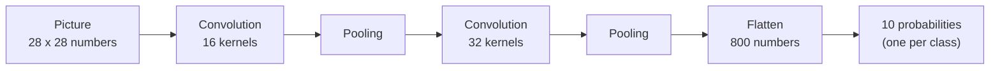
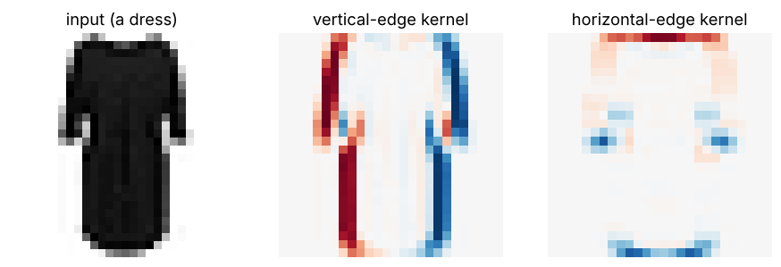

# FashionNet: learn convolutional neural networks step by step

> **After this tutorial you will be able to** explain how a computer "sees" a picture, build a small convolutional
> neural network (CNN) for clothes images, make it more robust with augmentation, judge it honestly, and
> look inside it with Grad-CAM.

[](https://colab.research.google.com/github/maryammahmoudi1993/FashionNet/blob/main/notebooks/01_images_as_numbers_and_first_cnn.ipynb)

> **Status: in progress.** Notebook 01 is ready. Notebooks 02 and 03 are planned (see the table of contents).

## Who this is for

- **For:** learners who know basic Python and NumPy and have never trained a neural network on images.
- **Not needed:** a GPU, a maths degree, or your own data. Everything runs on a laptop CPU.
- **Time:** about 25 minutes for notebook 01 (the training cells take roughly one minute).

## What you will learn (notebook 01)

- A picture is a grid of numbers, and why that matters.
- What a convolution and a pooling layer do, shown with hand-made kernels.
- How to train a first CNN and why it beats a network that ignores pixel neighbours.
- Why we keep separate training, validation and test sets.

## The pipeline in one picture



<p align="center">
  <br>
  <em>A convolution slides a small kernel over the picture. The vertical-edge kernel lights up the sides of the dress,
  the horizontal-edge kernel lights up shoulders and hem.</em>
</p>

## How to run

**In the browser (no installation):** click the Colab badge above. Colab already has TensorFlow;
the first cell downloads this repository for you.

**On your computer** (Python 3.13 was tested; any recent Python 3 that TensorFlow supports should work):

```bash
git clone https://github.com/maryammahmoudi1993/FashionNet.git
cd FashionNet
python -m venv .venv
source .venv/bin/activate
pip install -r requirements.txt
python -m ipykernel install --user --name python3
jupyter lab notebooks/
```

If `jupyter` is not found, run `pip install jupyterlab` first (it is not needed to run the tests).

Check that everything works (runs the smoke tests and every notebook, about two minutes):

```bash
python -m pytest -q
```

The data (Fashion-MNIST, a few megabytes) is downloaded automatically on the first run; see [`data/README.md`](data/README.md).

## Contents

| # | Notebook | You will learn | Status |
|---|---|---|---|
| 01 | [Images are numbers: your first CNN](notebooks/01_images_as_numbers_and_first_cnn.ipynb) | pixels, convolution, pooling, a first CNN, honest evaluation | ready |
| 02 | Make it robust: augmentation, learning curves, confusion matrix | planned | |
| 03 | Look inside: Grad-CAM, then versus now | planned | |

Other folders: [`src/`](src) shared code, [`tests/`](tests) smoke test and a test that runs every notebook,
[`legacy/`](legacy) the original 2023 files (untouched), [`assets/`](assets) figures and [credits](assets/CREDITS.md).

## Results so far

All numbers below come from running notebook 01 (fixed seed 42, CPU, 20,000 training pictures,
5,000 validation pictures, 10 epochs, evaluation on the official 10,000 Fashion-MNIST test pictures, one run each).

| Model | Parameters | Test accuracy |
|---|---|---|
| Flat-list network (one hidden layer, ignores neighbours) | 50,890 | 84.5% |
| First CNN (two convolution blocks) | 12,810 | 86.7% |

Chance level is 10%. One run with one seed is not a proof; notebook 02 will repeat the comparison with several seeds.

## Learning journey

| | **Then (2023, in [`legacy/`](legacy))** | **Now** |
|---|---|---|
| Goal | predict clothes *category* (4 classes) and *colour* (3 classes) with one network | recognise 10 clothes classes on a public data set |
| Model | 13 convolution layers (VGG-like), two output heads | 2 convolution layers, one output; deliberately small so you can follow every step |
| Data | a local, modified DeepFashion2 folder on a Windows path; not in the repository | Fashion-MNIST, downloaded automatically; licence documented |
| Evaluation | validation data was built with the *training* labels in `deep_net.py`; no seed; no results shown | separate train / validation / test sets, fixed seed, results table, tests |
| Explanation | none | pictures and a short "what to notice" after every cell |

What I would do differently: start small, keep a locked test set, fix the seed, and write down what each step teaches.
The original code did not run end to end (see [`legacy/ABOUT.md`](legacy/ABOUT.md)); it is kept as it was.

## Limitations

- Fashion-MNIST pictures are small (28 × 28), grey and centred; real shop photos are bigger, coloured and messier.
- Single runs, a subset of the training pictures and only 10 epochs: the numbers show a trend, not the best possible accuracy.
- The colour-and-category task of the first version is not repeated here.

## Further reading

- Xiao, Rasul, Vollgraf (2017), *Fashion-MNIST: a Novel Image Dataset for Benchmarking Machine Learning Algorithms*, <https://arxiv.org/abs/1708.07747>
- Keras documentation, [Conv2D layer](https://keras.io/api/layers/convolution_layers/convolution2d/) and [MaxPooling2D layer](https://keras.io/api/layers/pooling_layers/max_pooling2d/).
- The Fashion-MNIST repository and its MIT licence: <https://github.com/zalandoresearch/fashion-mnist>

## License

MIT, see [`LICENSE`](LICENSE). The Fashion-MNIST data set has its own MIT licence (copyright Zalando SE).
